<p align="center">
  <picture>
    <source media="(prefers-color-scheme: dark)" srcset="assets/banner-dark.svg">
    
  </picture>
</p>

# Claude Ads

Claude Ads is a free, open source skill for Claude Code. Give it your ad account data and it tells you what is working, what is broken, and what to fix first, across twelve ad platforms.

It is made for agencies, consultants, and in-house marketing teams. It reads your data and reports back. It does not change your accounts on its own.

> [!NOTE]
> You can get Claude Ads from two places: the **public release** at
> [`AgriciDaniel/claude-ads`](https://github.com/AgriciDaniel/claude-ads)
> (MIT licensed, no membership needed), and the **community mirror** at
> `AI-Marketing-Hub/claude-ads`, where
> [AI Marketing Hub Pro](https://www.skool.com/ai-marketing-hub-pro) members
> get early access and direct collaboration.

## Quickstart

1. Install (see [Installation](#installation)): `/plugin marketplace add agricidaniel/claude-ads`, then `/plugin install claude-ads@ai-marketing-hub-claude-ads`.
2. Run `/ads setup` and answer a few questions: your business model, goal, main conversion, monthly spend, active platforms, and who approves changes. Never paste API keys or tokens.
3. Bring evidence: an account export (CSV or JSON), screenshots, or a pasted summary with its date range, currency, and timezone.
4. Run `/ads audit google` (or `/ads audit all`). You get a report that states what passed, what failed, and what is missing.
5. Run `/ads report` to see a past run again, and `/ads next` to see the most important blocker.

<p align="center">
  <picture>
    <source media="(prefers-color-scheme: dark)" srcset="assets/how-it-works-dark.svg">
    
  </picture>
</p>

## What you can do

| You want to | Run | You get |
| --- | --- | --- |
| Find out what is wrong | `/ads audit` | A report of passed, failed, and unchecked items, each with its evidence |
| Decide where to spend | `/ads plan` | Channel, budget, measurement, and competitor plans |
| Make ads | `/ads create` | Copy, image, video, and product-photo briefs and assets |
| Keep watch | `/ads monitor` | Checks on pacing, delivery, tracking, ad fatigue, and policy |
| Improve results | `/ads optimize --draft` | Suggested changes, written as drafts |
| Test an idea | `/ads experiment` | A test design, or a readout of a finished test |

## Platforms

<p align="center">
  <picture>
    <source media="(prefers-color-scheme: dark)" srcset="assets/platforms-dark.svg">
    
  </picture>
</p>

Each platform has its own focused skill, audit worker, control reference, and capability declaration. The
[capability manifest](control-plane/manifests/capability-manifest.json) is the authoritative record of what can be read or changed live.

## Commands

Standalone installs use `/ads`. Claude Code plugins are namespaced and use
`/claude-ads:ads`. Both load the same `ads/SKILL.md` contract.

| Command | What it does |
| --- | --- |
| `/ads setup` | Save your client, account, goal, privacy, and guardrail profile |
| `/ads audit [all\|platform\|scope]` | Run a full or scoped audit backed by evidence |
| `/ads plan` | Build channel, campaign, budget, competitor, and measurement plans |
| `/ads create` | Produce copy, image, video, or product-photo assets |
| `/ads launch --draft` | Draft a campaign change plan without touching the account |
| `/ads monitor` | Review pacing, delivery, tracking, fatigue, policy, and performance |
| `/ads optimize --draft` | Draft evidence-backed improvements |
| `/ads experiment` | Design or read out a controlled test |
| `/ads report` | Render a saved run as Markdown, HTML, or PDF |
| `/ads research refresh` | Refresh platform, policy, API, and benchmark evidence |
| `/ads validate` | Check contracts, runs, capabilities, or release readiness |
| `/ads status`, `/ads next` | Show where things stand and the most important blocker |

Platform shortcuts such as `/ads google`, `/ads meta`, `/ads amazon`, and
`/ads reddit` go straight to that platform's audit.

## Built to be trusted

<p align="center">
  <picture>
    <source media="(prefers-color-scheme: dark)" srcset="assets/trust-dark.svg">
    
  </picture>
</p>

Every check ends in one of four results: `pass`, `fail`, `unknown`, or `not_applicable`. Unknown is a real answer. It means the data was missing, and it is never guessed.

## Claude Ads Cockpit (optional)

Cockpit is a separate, optional companion (version 0.1.0, plugin ID `ads-cockpit`). `/ads-cockpit` opens a local workbench where you can look through a finished audit: its status, evidence, missing inputs, comparisons with an earlier run, and report receipts. A built-in demo with synthetic data lets you try it without any account.

Task counts stay separate from health scores, and every scoring profile in the scoring manifest stays disabled. See the [Cockpit guide](docs/cockpit/user-guide.md) and its
[compatibility and acceptance limits](docs/cockpit/compatibility.md).

## Installation

Claude Code is the canonical runtime. Codex, Gemini, Cursor, Windsurf, Goose,
and compatible Agent Skills hosts can consume the same skill files where their
runtime supports them.

Prefer the host's native plugin flow or a tagged release archive with a verified
SHA-256 checksum. Never pipe a remote installer directly to a shell.

For Claude Code, the native plugin flow is:

```text
/plugin marketplace add agricidaniel/claude-ads
/plugin install claude-ads@ai-marketing-hub-claude-ads
```

If you added this marketplace before v2.0.0, Claude Code still holds it under
the stale local alias `agricidaniel-claude-ads`. Remove that alias, then re-add
and install:

```text
/plugin marketplace remove agricidaniel-claude-ads
/plugin marketplace add agricidaniel/claude-ads
/plugin install claude-ads@ai-marketing-hub-claude-ads
```

Managed dependencies require CPython 3.11 or 3.12. Linux x86_64 requires glibc
2.28 or later; musl is unsupported. macOS 11 x86_64/arm64 and Windows amd64
remain declared wheel targets and require native CI qualification.
CI checks the Linux minimum in an AlmaLinux 8 glibc 2.28 container with both
supported interpreters. This checks Python wheels and the managed CLI lifecycle;
browser payloads and PDF system libraries require separate host verification.

Or install from a local clone of the public repository:

```bash
git clone https://github.com/AgriciDaniel/claude-ads.git
cd claude-ads
bash install.sh --source=local
```

Select another standalone host explicitly:

```bash
bash install.sh --target=codex --source=local
bash install.sh --target=gemini --source=local --no-deps
```

> [!WARNING]
> **EXPERIMENTAL:** Only Claude Code is verified. The Codex, Gemini, Cursor,
> Windsurf, and Goose targets install the same skill artifacts under each host's
> expected directory, but that host's runtime conventions may differ. Confirm the
> result in your host, and pin the install locations with `--skill-dir` and
> `--agent-dir` if the auto-detected paths are wrong. The installer creates the
> managed Python environment only for the `claude` and `codex` targets.

`--source=git` (the default when the installer is run outside a checkout) clones
the default branch HEAD, which is unpinned and is not a verified release. Prefer
`--source=local` from a checkout you have reviewed, or a release archive.

To pin a git install, add the opt-in `--ref` option (PowerShell: `-Ref`) with a
tag, branch, or commit. It is valid only with `--source=git`. The installer
validates the value strictly, checks it out detached, prints the resolved full
commit SHA, and fails before installing anything if the ref does not resolve:

```bash
bash install.sh --source=git --ref=v2.1.0
```

A git ref is not a checksum-verified release, and nothing here is signed. A
release zip checked with the `SHA256SUMS` recipe below remains the verified path.

PowerShell uses the same managed ownership model:

```powershell
git clone https://github.com/AgriciDaniel/claude-ads.git
Set-Location claude-ads
.\install.ps1 -Source local
```

Verify a release archive before using it. Each GitHub release publishes the zip,
`release-manifest.json`, `sbom.cdx.json`, and a `SHA256SUMS` file. Releases are
checksummed, not signed, so a checksum confirms the files match what the release
published and is not an independent proof of origin. Download all four files into
one empty directory, then run:

```bash
sha256sum -c SHA256SUMS      # macOS: shasum -a 256 -c SHA256SUMS
```

Every line must report `OK` before you unzip and run `bash install.sh --source=local`
from the extracted folder.

Managed dependencies support CPython 3.11 and 3.12 on the declared Linux,
macOS, and Windows wheel matrix. Unsupported interpreters fail before the
destination changes. Use `--no-deps` or `-NoDeps` for a skill-only install.

Browser capture requires an operator-installed Playwright browser payload. PDF
rendering requires the host's WeasyPrint and Pango system libraries. These are
documented in the
[external runtime dependency manifest](control-plane/manifests/external-runtime-dependencies.json).

Uninstall only manifest-owned files:

```bash
bash uninstall.sh --target=claude
```

The PowerShell equivalent is `uninstall.ps1`.

The Bash and PowerShell skill installers do not enable or load Cockpit. Its
optional plugin has its own marketplace entry and curated archive, and requires
an explicitly bound trusted core and Python executable. Installing the main
skill alone preserves the existing experience.

## Project status

> [!IMPORTANT]
> **Status: development candidate.** Claude Ads is not release-ready until every
> gate in [control-plane/RELEASE_REQUIREMENTS.md](control-plane/RELEASE_REQUIREMENTS.md)
> passes in a fresh verification context.
>
> - All twelve account-health scoring profiles are disabled, so no health score is
>   produced. Audits report findings, unknowns, and evidence coverage instead.
> - The Cockpit companion is optional and not yet natively accepted; see its
>   [compatibility and acceptance limits](docs/cockpit/compatibility.md).
> - Account changes stay drafts unless the full mutation gate passes.

## For engineers and contributors

<details>
<summary>How it is built, how scoring works, safety gates, and how to run the tests</summary>

### Architecture

One conductor owns scope, policy, aggregation, and final artifacts. Workers
analyze bounded slices and return schema-valid findings. Required-worker failure
makes the run partial. It is never silently presented as a complete audit.

Agent definitions omit model pins. The host or invocation selects the model;
Claude Code inherits the main conversation's model when no higher-priority
selection applies. See the [official subagent model documentation](https://code.claude.com/docs/en/sub-agents#choose-a-model).

The canonical result is versioned JSON. Markdown, HTML, and PDF are renderings
of the same validated run bundle.


### Scoring and evidence

Controls use `pass`, `fail`, `unknown`, or `not_applicable`.

- Health, evidence coverage, regulatory exposure, and opportunities stay separate.
- Unknown controls reduce evidence coverage without changing known health.
- Coverage of 80% or more is graded, 60 to 79% is provisional, and below 60%
  is insufficient evidence.
- Optional, beta, premium, unavailable, and ineligible features stay unscored.
- A disabled or unapproved platform profile produces no health score.
- A failed platform is excluded from portfolio scoring and makes the run partial.

See the [scoring reference](ads/references/scoring-system.md) and production
implementation in `claude_ads_core/scoring.py`.


### Account safety

All adapters are read-only by default. Applying a change requires:

1. A tested and enabled capability for the exact operation.
2. Explicit account and object IDs.
3. A human-readable before and after diff with blast radius.
4. Owner approval within account-defined ceilings.
5. An idempotency key, audit destination, rollback, and verification window.
6. Verification that remote state still matches the mutation precondition.

Missing ceilings mean no write. Permanent deletion is not supported in v2.
Credentials belong in environment variables, an OS keychain, or an approved
secret manager. They never belong in the repository, profiles, reports, or logs.


### Evidence and release controls

The public-safe `control-plane/` records product boundaries, dated sources,
claims, capabilities, safety rules, privacy rules, ecosystem decisions, and
release requirements.

- No source means no current platform claim.
- No implementation, fixture, and test means no capability claim.
- No approval and rollback means no account mutation.
- No independent verification means no release.

See the [release requirements](control-plane/RELEASE_REQUIREMENTS.md) and
[publishing policy](control-plane/PUBLISHING_POLICY.md).

The MIT public distribution and private development/community repository have
separate publication boundaries. Local verification does not authorize a new
release, a visibility change, or publication of private review evidence.

Runtime commands locate policy beside the source checkout or in the curated
standalone installation. Use `--policy-root ROOT` for another explicit policy
location. `status` and `next` retain `--root ROOT` as a compatibility alias;
commands never select policy from an unrelated working directory. Repository
audit and release helpers require a source checkout.

Public scoring uses the canonical registry. Legacy control and category-weight
inputs are accepted only when they exactly match approved policy. Report status
and rendering reject fabricated health or incompatible historical bundles;
regenerate those bundles using the current registry. All twelve production
health profiles remain disabled, returning null health and zero approved
coverage until a severity and weight policy is approved.


### Development

Create a virtual environment and run the complete suite:

```bash
python3.12 -m venv .venv
.venv/bin/python -m pip install --no-deps -e .
.venv/bin/python -m pip install --require-hashes --only-binary=:all: -r requirements.lock
.venv/bin/python -m pip install --require-hashes --only-binary=:all: -r requirements-dev.lock
.venv/bin/python -m pip install --require-hashes --only-binary=:all: -r .github/requirements-schema-tests.lock
.venv/bin/python -m pip check
.venv/bin/python -m pytest -q
```

Useful focused checks:

```bash
python -m claude_ads_core --version
python -m claude_ads_core validate finding path/to/finding.json
bash -n install.sh uninstall.sh
```


### Reference documents

- [Cockpit implementation contract](docs/cockpit/implementation-contract.md): the integration boundary for the optional companion.
- [Requirement index](control-plane/REQUIREMENT_INDEX.md): the stable requirement IDs the tracker ledger maps to.
- [Control schema migration, v1 to v2](control-plane/migrations/control-schemas-v1-to-v2.md): what changed in the control schemas.

### Repository map

```text
ads/                  main skill, interface metadata, and shared references
skills/               platform and lifecycle skills
agents/               platform, cross-platform, research, and verifier workers
claude_ads_core/      typed contracts, adapters, validation, and scoring
control-plane/        evidence, capability, safety, maturity, and release state
scripts/              browser, creative, reporting, and release helpers
evals/                routing and behavioral evaluation cases
tests/                deterministic, security, installer, and adapter tests
```


</details>

## Contributing

Found a problem or have an idea? See [CONTRIBUTING.md](CONTRIBUTING.md).

Thank you to everyone who has reported issues and proposed fixes: [@aleps001](https://github.com/aleps001), [@bq9kpv2h98-max](https://github.com/bq9kpv2h98-max), [@haruntekin89](https://github.com/haruntekin89), [@reikjarloekl](https://github.com/reikjarloekl), [@osilova](https://github.com/osilova), [@Nath24591](https://github.com/Nath24591), [@sistemasond-ux](https://github.com/sistemasond-ux), [@principisimone-sys](https://github.com/principisimone-sys), [@HarKro753](https://github.com/HarKro753), [@plcosta](https://github.com/plcosta), [@ulises2k](https://github.com/ulises2k), [@kutzki](https://github.com/kutzki), [@SamaEducationalCo](https://github.com/SamaEducationalCo), [@Bortlesboat](https://github.com/Bortlesboat), [@gabbyran2026-gif](https://github.com/gabbyran2026-gif), [@AbundantASG](https://github.com/AbundantASG), [@hendrixfreire](https://github.com/hendrixfreire), [@josefresco](https://github.com/josefresco), [@dead-simba](https://github.com/dead-simba), [@c6zks4gssn-droid](https://github.com/c6zks4gssn-droid), [@kershrita](https://github.com/kershrita), [@popey](https://github.com/popey), [@xiaolai](https://github.com/xiaolai), [@seojcarlos](https://github.com/seojcarlos), [@botbikamordehai2-sketch](https://github.com/botbikamordehai2-sketch). What each person contributed is listed in [CONTRIBUTING.md](CONTRIBUTING.md#contributors-and-acknowledgments).

## Privacy

Client data, raw private research, captured prompts, credentials, account
exports, and agent transcripts never belong in Git history, reports, or release
archives. Keep credentials in environment variables, an OS keychain, or an
approved secret manager.

## License

Original Claude Ads code and documentation are available under the MIT License.
Third-party APIs, trademarks, documentation, and cited artifacts remain subject
to their own terms. Review the [source ledger](control-plane/manifests/source-ledger.json)
and [third-party notices](THIRD_PARTY_NOTICES.md) before importing external work.
