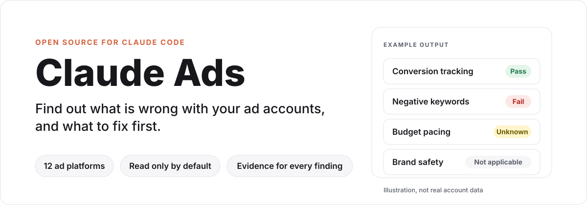

<p align="center">
  
</p>

# Claude Ads

Claude-first, portable paid-media operations for agencies, consultants, and
in-house performance teams.

Claude Ads turns authorized exports or account reads into source-grounded
audits, plans, creative workflows, experiments, monitoring, and reports. It is
read-only by default. Live changes stay disabled until the exact platform and
operation pass approval, idempotency, verification, audit, and rollback gates.

> [!NOTE]
> Claude Ads ships from two homes: the **public release** at
> [`AgriciDaniel/claude-ads`](https://github.com/AgriciDaniel/claude-ads)
> (MIT, no membership required) and the **community mirror** at
> `AI-Marketing-Hub/claude-ads`, where
> [AI Marketing Hub Pro](https://www.skool.com/ai-marketing-hub-pro) members
> get early access and direct collaboration.

> [!IMPORTANT]
> **Status: development candidate.** Claude Ads is not release-ready until every
> gate in [control-plane/RELEASE_REQUIREMENTS.md](control-plane/RELEASE_REQUIREMENTS.md)
> passes in a fresh verification context.
>
> - All twelve account-health scoring profiles are disabled, so no health score is
>   produced. Audits report findings, unknowns, and evidence coverage instead.
> - The Cockpit companion is optional and not yet natively accepted; see its
>   [compatibility and acceptance limits](docs/cockpit/compatibility.md).
> - Account changes stay drafts unless the full mutation gate passes.

## Quickstart

1. Install (see [Installation](#installation)): `/plugin marketplace add agricidaniel/claude-ads`, then `/plugin install claude-ads@ai-marketing-hub-claude-ads`.
2. Run `/ads setup` and answer the intake: business model, objective, primary conversion, monthly spend, active platforms, and who may approve changes. Never paste API keys or tokens.
3. Bring evidence: an account export (CSV or JSON), screenshots, or a pasted metrics summary with its date range, currency, and timezone.
4. Run `/ads audit google` (or `/ads audit all`) for a source-grounded audit: JSON bundle, then Markdown or HTML, with missing data and unknowns stated.
5. Run `/ads report` to re-render a prior run and `/ads next` to see the highest-priority blocker.

<p align="center">
  
</p>

## What it does

- Audits paid-media accounts with dated evidence and explicit confidence.
- Plans campaigns, channels, budgets, measurement, and experiments.
- Creates copy, image, video, and product-photo briefs and assets.
- Monitors pacing, delivery, tracking, fatigue, policy, and performance.
- Produces versioned JSON, then renders Markdown, HTML, and optional PDF.
- Drafts safe account changes without applying them by default.
- Reports missing data, stale sources, contradictions, and partial failures.

## Platforms

<p align="center">
  
</p>

| Segment | Platforms |
| --- | --- |
| Search, video, and social | Google Ads, Meta Ads, YouTube Ads, LinkedIn Ads, TikTok Ads, Microsoft Advertising, Reddit Ads, Snapchat Ads, X Ads |
| Commerce and retail media | Apple Ads, Amazon Ads, Pinterest Ads |

Each platform has a focused skill, audit worker, control reference, capability
declaration, and testable routing surface. The
[capability manifest](control-plane/manifests/capability-manifest.json) is the
authoritative record for live reads and writes.

## Commands

Standalone installs use `/ads`. Claude Code plugins are namespaced and use
`/claude-ads:ads`. Both load the same `ads/SKILL.md` contract.

| Command | Outcome |
| --- | --- |
| `/ads setup` | Create the client, account, KPI, privacy, and guardrail profile |
| `/ads audit [all\|platform\|scope]` | Run a complete or scoped evidence-backed audit |
| `/ads plan` | Build channel, campaign, budget, competitor, and measurement plans |
| `/ads create` | Produce copy, image, video, or product-photo assets |
| `/ads launch --draft` | Draft a campaign mutation plan without changing the account |
| `/ads monitor` | Review pacing, delivery, tracking, fatigue, policy, and performance |
| `/ads optimize --draft` | Draft evidence-backed optimization changes |
| `/ads experiment` | Design or read out a controlled test |
| `/ads report` | Render a validated JSON run bundle |
| `/ads research refresh` | Refresh platform, policy, API, benchmark, and ecosystem evidence |
| `/ads validate` | Validate contracts, runs, capabilities, maturity, or release readiness |
| `/ads status`, `/ads next` | Show current status and the highest-priority blocker |

Platform shortcuts such as `/ads google`, `/ads meta`, `/ads amazon`, and
`/ads reddit` route to the matching platform audit.

Claude Ads Cockpit is a separately enabled companion, version 0.1.0, with the
runtime plugin ID `ads-cockpit`. `/ads-cockpit` opens a local workbench for run
states, evidence, missing inputs, comparisons, and report receipts. Its isolated
synthetic demo is intended for walkthroughs. Explicit actions can validate inputs
or runs and render Markdown, HTML, or conditional PDF reports. Task completion
counts remain separate from health scores, and every scoring profile in the
scoring manifest stays disabled. See the [Cockpit guide](docs/cockpit/user-guide.md) and
[compatibility and acceptance limits](docs/cockpit/compatibility.md).

## Demo

<p align="center">
  
</p>

The GIF shows the original command-discovery experience. The v2 command table
above and the platform table are current and authoritative.

## Installation

Claude Code is the canonical runtime. Codex, Gemini, Cursor, Windsurf, Goose,
and compatible Agent Skills hosts can consume the same skill files where their
runtime supports them.

Prefer the host's native plugin flow or a tagged release archive with a verified
SHA-256 checksum. Never pipe a remote installer directly to a shell.

For Claude Code, the native plugin flow is:

```text
/plugin marketplace add agricidaniel/claude-ads
/plugin install claude-ads@ai-marketing-hub-claude-ads
```

If you added this marketplace before v2.0.0, Claude Code still holds it under
the stale local alias `agricidaniel-claude-ads`. Remove that alias, then re-add
and install:

```text
/plugin marketplace remove agricidaniel-claude-ads
/plugin marketplace add agricidaniel/claude-ads
/plugin install claude-ads@ai-marketing-hub-claude-ads
```

Managed dependencies require CPython 3.11 or 3.12. Linux x86_64 requires glibc
2.28 or later; musl is unsupported. macOS 11 x86_64/arm64 and Windows amd64
remain declared wheel targets and require native CI qualification.
CI checks the Linux minimum in an AlmaLinux 8 glibc 2.28 container with both
supported interpreters. This checks Python wheels and the managed CLI lifecycle;
browser payloads and PDF system libraries require separate host verification.

Or install from a local clone of the public repository:

```bash
git clone https://github.com/AgriciDaniel/claude-ads.git
cd claude-ads
bash install.sh --source=local
```

Select another standalone host explicitly:

```bash
bash install.sh --target=codex --source=local
bash install.sh --target=gemini --source=local --no-deps
```

> [!WARNING]
> **EXPERIMENTAL:** Only Claude Code is verified. The Codex, Gemini, Cursor,
> Windsurf, and Goose targets install the same skill artifacts under each host's
> expected directory, but that host's runtime conventions may differ. Confirm the
> result in your host, and pin the install locations with `--skill-dir` and
> `--agent-dir` if the auto-detected paths are wrong. The installer creates the
> managed Python environment only for the `claude` and `codex` targets.

`--source=git` (the default when the installer is run outside a checkout) clones
the default branch HEAD, which is unpinned and is not a verified release. Prefer
`--source=local` from a checkout you have reviewed, or a release archive.

To pin a git install, add the opt-in `--ref` option (PowerShell: `-Ref`) with a
tag, branch, or commit. It is valid only with `--source=git`. The installer
validates the value strictly, checks it out detached, prints the resolved full
commit SHA, and fails before installing anything if the ref does not resolve:

```bash
bash install.sh --source=git --ref=v2.0.2
```

A git ref is not a checksum-verified release, and nothing here is signed. A
release zip checked with the `SHA256SUMS` recipe below remains the verified path.

PowerShell uses the same managed ownership model:

```powershell
git clone https://github.com/AgriciDaniel/claude-ads.git
Set-Location claude-ads
.\install.ps1 -Source local
```

Verify a release archive before using it. Each GitHub release publishes the zip,
`release-manifest.json`, `sbom.cdx.json`, and a `SHA256SUMS` file. Releases are
checksummed, not signed, so a checksum confirms the files match what the release
published and is not an independent proof of origin. Download all four files into
one empty directory, then run:

```bash
sha256sum -c SHA256SUMS      # macOS: shasum -a 256 -c SHA256SUMS
```

Every line must report `OK` before you unzip and run `bash install.sh --source=local`
from the extracted folder.

Managed dependencies support CPython 3.11 and 3.12 on the declared Linux,
macOS, and Windows wheel matrix. Unsupported interpreters fail before the
destination changes. Use `--no-deps` or `-NoDeps` for a skill-only install.

Browser capture requires an operator-installed Playwright browser payload. PDF
rendering requires the host's WeasyPrint and Pango system libraries. These are
documented in the
[external runtime dependency manifest](control-plane/manifests/external-runtime-dependencies.json).

Uninstall only manifest-owned files:

```bash
bash uninstall.sh --target=claude
```

The PowerShell equivalent is `uninstall.ps1`.

The Bash and PowerShell skill installers do not enable or load Cockpit. Its
optional plugin has its own marketplace entry and curated archive, and requires
an explicitly bound trusted core and Python executable. Installing the main
skill alone preserves the existing experience.

## Architecture

<p align="center">
  
</p>

One conductor owns scope, policy, aggregation, and final artifacts. Workers
analyze bounded slices and return schema-valid findings. Required-worker failure
makes the run partial. It is never silently presented as a complete audit.

Agent definitions omit model pins. The host or invocation selects the model;
Claude Code inherits the main conversation's model when no higher-priority
selection applies. See the [official subagent model documentation](https://code.claude.com/docs/en/sub-agents#choose-a-model).

The canonical result is versioned JSON. Markdown, HTML, and PDF are renderings
of the same validated run bundle.

## Scoring and evidence

<p align="center">
  
</p>

Controls use `pass`, `fail`, `unknown`, or `not_applicable`.

- Health, evidence coverage, regulatory exposure, and opportunities stay separate.
- Unknown controls reduce evidence coverage without changing known health.
- Coverage of 80% or more is graded, 60 to 79% is provisional, and below 60%
  is insufficient evidence.
- Optional, beta, premium, unavailable, and ineligible features stay unscored.
- A disabled or unapproved platform profile produces no health score.
- A failed platform is excluded from portfolio scoring and makes the run partial.

See the [scoring reference](ads/references/scoring-system.md) and production
implementation in `claude_ads_core/scoring.py`.

## Account safety

All adapters are read-only by default. Applying a change requires:

1. A tested and enabled capability for the exact operation.
2. Explicit account and object IDs.
3. A human-readable before and after diff with blast radius.
4. Owner approval within account-defined ceilings.
5. An idempotency key, audit destination, rollback, and verification window.
6. Verification that remote state still matches the mutation precondition.

Missing ceilings mean no write. Permanent deletion is not supported in v2.
Credentials belong in environment variables, an OS keychain, or an approved
secret manager. They never belong in the repository, profiles, reports, or logs.

## Evidence and release controls

The public-safe `control-plane/` records product boundaries, dated sources,
claims, capabilities, safety rules, privacy rules, ecosystem decisions, and
release requirements.

- No source means no current platform claim.
- No implementation, fixture, and test means no capability claim.
- No approval and rollback means no account mutation.
- No independent verification means no release.

See the [release requirements](control-plane/RELEASE_REQUIREMENTS.md) and
[publishing policy](control-plane/PUBLISHING_POLICY.md).

The MIT public distribution and private development/community repository have
separate publication boundaries. Local verification does not authorize a new
release, a visibility change, or publication of private review evidence.

Runtime commands locate policy beside the source checkout or in the curated
standalone installation. Use `--policy-root ROOT` for another explicit policy
location. `status` and `next` retain `--root ROOT` as a compatibility alias;
commands never select policy from an unrelated working directory. Repository
audit and release helpers require a source checkout.

Public scoring uses the canonical registry. Legacy control and category-weight
inputs are accepted only when they exactly match approved policy. Report status
and rendering reject fabricated health or incompatible historical bundles;
regenerate those bundles using the current registry. All twelve production
health profiles remain disabled, returning null health and zero approved
coverage until a severity and weight policy is approved.

## Development

Create a virtual environment and run the complete suite:

```bash
python3.12 -m venv .venv
.venv/bin/python -m pip install --no-deps -e .
.venv/bin/python -m pip install --require-hashes --only-binary=:all: -r requirements.lock
.venv/bin/python -m pip install --require-hashes --only-binary=:all: -r requirements-dev.lock
.venv/bin/python -m pip install --require-hashes --only-binary=:all: -r .github/requirements-schema-tests.lock
.venv/bin/python -m pip check
.venv/bin/python -m pytest -q
```

Useful focused checks:

```bash
python -m claude_ads_core --version
python -m claude_ads_core validate finding path/to/finding.json
bash -n install.sh uninstall.sh
```

## Repository map

```text
ads/                  main skill, interface metadata, and shared references
skills/               platform and lifecycle skills
agents/               platform, cross-platform, research, and verifier workers
claude_ads_core/      typed contracts, adapters, validation, and scoring
control-plane/        evidence, capability, safety, maturity, and release state
scripts/              browser, creative, reporting, and release helpers
evals/                routing and behavioral evaluation cases
tests/                deterministic, security, installer, and adapter tests
```

## Contributors and acknowledgments

Claude Ads benefits from community bug reports, feature requests, and proposed
fixes. Thank you to the following contributors whose work informed v2.0.2.
Some proposals were independently implemented or superseded; these credits
recognize the contribution without implying that every submitted patch was merged.

| Contributor | Contribution | Discussion |
| --- | --- | --- |
| [@principisimone-sys](https://github.com/principisimone-sys) | Search and DSA overlap request | [#65](https://github.com/AgriciDaniel/claude-ads/issues/65) |
| [@HarKro753](https://github.com/HarKro753) | Meta account, Pixel, and conversion cold-start request | [#53](https://github.com/AgriciDaniel/claude-ads/issues/53) |
| [@plcosta](https://github.com/plcosta) | Marketplace case-normalization report and proposed documentation fix | [#17](https://github.com/AgriciDaniel/claude-ads/issues/17), [#18](https://github.com/AgriciDaniel/claude-ads/pull/18) |
| [@ulises2k](https://github.com/ulises2k) | Stale marketplace-alias installation report | [#56](https://github.com/AgriciDaniel/claude-ads/issues/56) |
| [@kutzki](https://github.com/kutzki) | Windows dependency-lock and older-install update report | [#57](https://github.com/AgriciDaniel/claude-ads/issues/57) |
| [@SamaEducationalCo](https://github.com/SamaEducationalCo) | Misleading grades after failed landing-page analysis | [#61](https://github.com/AgriciDaniel/claude-ads/issues/61) |
| [@Bortlesboat](https://github.com/Bortlesboat) | Proposed landing-page analysis failure fix | [#66](https://github.com/AgriciDaniel/claude-ads/pull/66) |
| [@gabbyran2026-gif](https://github.com/gabbyran2026-gif) | Proposed target-lock test subprocess fix | [#58](https://github.com/AgriciDaniel/claude-ads/pull/58) |
| [@AbundantASG](https://github.com/AbundantASG) | Proposed scoped target-lock test subprocess fix | [#59](https://github.com/AgriciDaniel/claude-ads/pull/59) |
| [@hendrixfreire](https://github.com/hendrixfreire) | Sensitive-file ignore-pattern report | [#32](https://github.com/AgriciDaniel/claude-ads/issues/32) |
| [@josefresco](https://github.com/josefresco) | Non-actionable Smart Conversions removal advice report | [#50](https://github.com/AgriciDaniel/claude-ads/issues/50) |
| [@dead-simba](https://github.com/dead-simba) | Request to revisit Meta architecture guidance | [#15](https://github.com/AgriciDaniel/claude-ads/issues/15) |
| [@c6zks4gssn-droid](https://github.com/c6zks4gssn-droid) | Repository-tooling proposal, including CodeQL | [#29](https://github.com/AgriciDaniel/claude-ads/pull/29) |

See [CONTRIBUTING.md](CONTRIBUTING.md) to report a problem or propose a change.

## Privacy

Client data, raw private research, captured prompts, credentials, account
exports, and agent transcripts must never enter Git history, reports, or release
archives. Keep credentials in environment variables, an OS keychain, or an
approved secret manager.

## License

Original Claude Ads code and documentation are available under the MIT License.
Third-party APIs, trademarks, documentation, and cited artifacts remain subject
to their own terms. Review the [source ledger](control-plane/manifests/source-ledger.json)
and [third-party notices](THIRD_PARTY_NOTICES.md) before importing external work.
